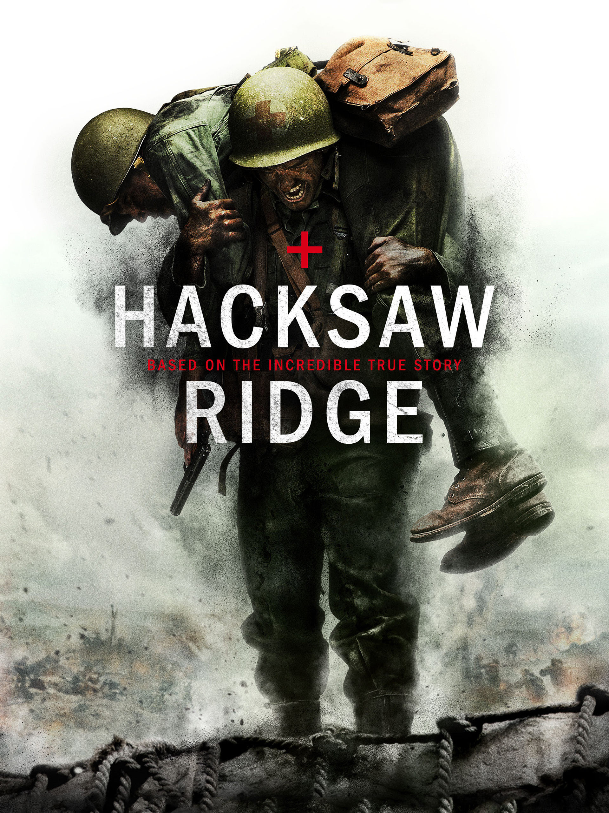

# app-dev
My first repository

<!-- ABOUT THE PROJECT -->
## Hacksaw Ridge

Desmond Doss is a deeply religious Seventh-day Adventist who serves as a combat medic in World War II. Defined by his absolute refusal to carry a weapon or take a human life, he overcomes intense military hostility and ostracization to prove his courage. During the Battle of Okinawa, his fierce conviction drives him to single-handedly save 75 wounded men on Hacksaw Ridge, making him the first conscientious objector to receive the Congressional Medal of Honor.

Here's why I like this movie:
* Desmond Doss saves 75 hurt soldiers in World War II without ever using a gun.
* He shows great bravery by standing up for what he believes in, even when others laugh at him.
* The battle scenes look very real, which makes his rescues feel like a true miracle. :smile:

